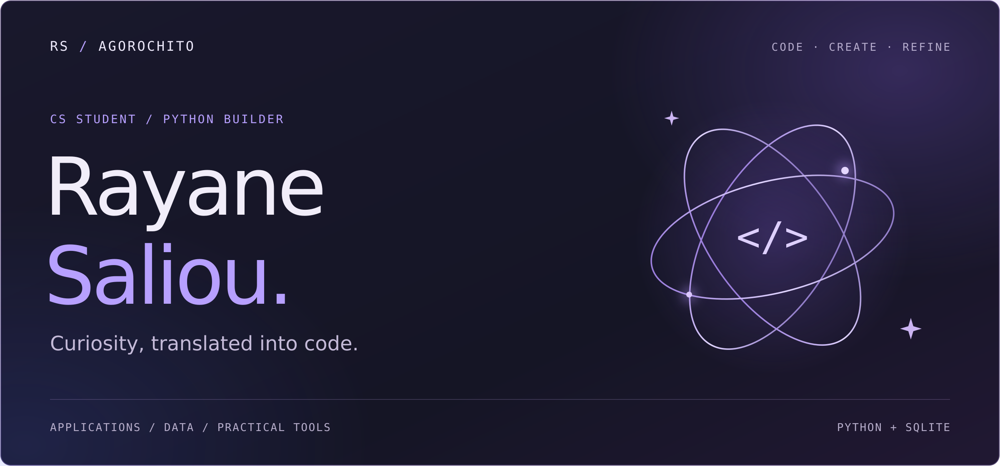

  

CS at **Colgate University, Class of 2030**. I build Python applications, interactive dashboards, and practical tools, learning through the process of developing, testing, and improving them.

[**LinkedIn ↗**](https://www.linkedin.com/in/rayane-saliou/) · [**Explore my repositories ↗**](https://github.com/Agorochito?tab=repositories)

## Selected work

### 01 / CourtVision

An interactive NBA analytics dashboard for exploring player-season performance, comparing players, and visualizing statistical trends. Includes scoring consistency calculations, shooting efficiency metrics, and SQLite storage for player and season statistics.

**Python · Streamlit · SQLite · Pandas · NumPy · Matplotlib**

[**Live demo ↗**](https://courtvision-lshtryw3bfxsvvnhztzyou.streamlit.app) · [**Source code ↗**](https://github.com/Agorochito/Courtvision)

The public demo uses historical NBA data snapshots for selected players and seasons.

---

### 02 / Personal File Intelligence Tool

A Python tool that recursively analyzes folders, categorizes files, and summarizes storage usage. Detects duplicate files using SHA-256 hashing and estimates recoverable space while keeping one copy of each file.

**Python · File systems · SHA-256 hashing**

[**Source code ↗**](https://github.com/Agorochito/personal_file_intelligence)

## Working with

**Programming:** Python, HTML/CSS  
**Applications and data:** Streamlit, SQLite, Pandas, NumPy, Matplotlib  
**Development:** Git, GitHub, VS Code
